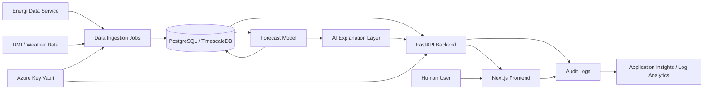

# Architecture

## High-Level Architecture

FlexSignal AI is designed as a modular, Azure-hosted decision-support platform. The system ingests electricity and weather data, stores time-series data, runs forecasting jobs, serves forecast results through an API, and presents read-only recommendations to authenticated users.

`v0.1` must not connect to control systems or send operational signals.

## Frontend

- Next.js with TypeScript.
- Authenticated through Microsoft Entra ID.
- Displays forecasts, explanations, confidence, economic potential, and audit history.
- Read-only decision-support interface only.

## Backend

- Python FastAPI service.
- Provides APIs for forecasts, recommendations, explanations, and audit records.
- Enforces authorization and read-only MVP boundaries.
- Does not expose control or activation endpoints.

## Database

- PostgreSQL with TimescaleDB for time-series data.
- Stores ingested data, forecast outputs, recommendation records, model metadata, and audit logs.
- Database schema is not implemented in the initial baseline.

## Data Ingestion

- Azure Functions or Azure Container Apps Jobs for scheduled ingestion.
- Planned sources include Energi Data Service and DMI/weather data.
- Jobs should validate data quality and record ingestion metadata.

## Forecast Model

- Initial model should be simple and explainable.
- Candidate approaches include rules, statistics, regression, XGBoost, or LightGBM.
- LLMs must not be used as the primary forecast model.

## AI Explanation Layer

- LLMs may generate explanations, summaries, and recommendation text.
- LLM output must be based on model outputs and source data.
- LLMs must not be the sole decision-making component.
- All recommendation text requires human review.

## Audit Logging

- Log forecast generation events.
- Log recommendation generation events.
- Log explanation generation events.
- Log user review and acknowledgement actions.
- Preserve enough metadata to support traceability and incident review.

## Azure Hosting

- Frontend and backend hosted on Azure App Service or Azure Container Apps.
- Data jobs hosted on Azure Functions or Azure Container Apps Jobs.
- Secrets stored in Azure Key Vault.
- Logs and telemetry sent to Application Insights and Log Analytics.
- Authentication through Microsoft Entra ID.

## Diagram

